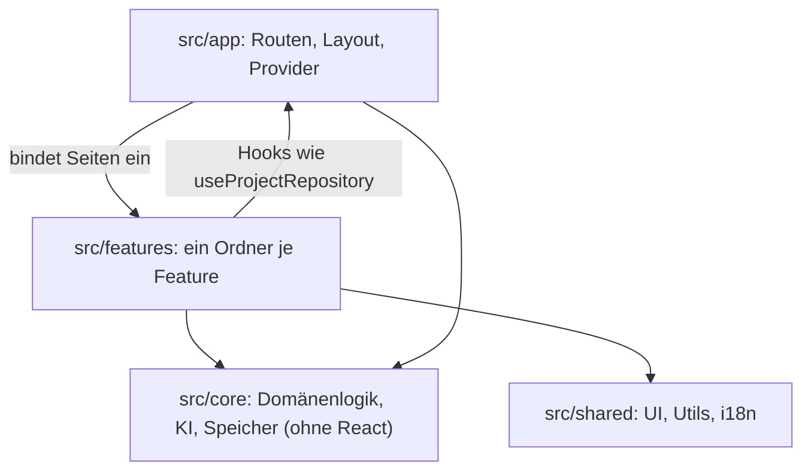

# Architektur-Überblick

Dieser Text zeigt, wie der Blueprint-Wizard aufgebaut ist und wo welche Logik liegt. Stand: Phase 9, Version 1.0.0.
Die verbindlichen Arbeitsregeln stehen in [CLAUDE.md](../CLAUDE.md), die Begründung einzelner Entscheidungen in den [ADRs](adr/) (Liste am Ende).

## 1. Schichten

- **`src/core`**: reine TypeScript-Logik ohne React. Unterordner: `blueprint/` (Schema, Abschnitte, Migrationen, Bearbeiten), `engine/` (Fragenmotor, Entscheidungen, Vorschläge, Widersprüche, Ideenfindung, Einordnung), `ai/` (Anbieter, strukturierte Antworten, Prompts, Kosten), `storage/` (Repositories), `settings/`, `ideation/` (Sitzung der Ideenfindung), `export/` (Generatoren, Reife-Check, ZIP).
- **`src/features/<feature>`**: Seiten, Komponenten und Hooks je Feature (`wizard`, `ideation`, `projects`, `blueprint`, `interview`, `decisions`, `export`, `settings`, `home`, `ai`). Jedes Feature hat einen Einstieg über einen Hook, etwa `useInterview(editor)`.
- **`src/shared`**: `ui/` (Button, Dialog, Input, Select im shadcn-Stil), `lib/` (Formatierung, Download, Slugs), `i18n/` (Setup und Sprachdateien).
- **`src/app`**: Routing (`routes.tsx`), Layout, `SettingsProvider`, `ProjectRepositoryContext`, Darstellung (`useAppearance`), Kostenanzeige.
- **`src/test`**: Testhilfen: MSW-Server und Handler, `renderRoute`, Speicher-Attrappen.

Abhängigkeitsregeln:

- `core` importiert nichts aus `react`, `app` oder `features`. ESLint erzwingt das (`no-restricted-imports` in `eslint.config.js`).
- Features nutzen die Logik aus `core` und einige Hooks aus `app`.
- Eine Ausnahme gibt es: `src/core/export/testing.ts` liest `de.json` aus `shared`. Die Datei ist eine Testhilfe und reicht nur Daten weiter. Der Kern selbst kennt weder i18next noch Oberflächentexte.

## 2. Datenfluss vom Schema zur Oberfläche

1. **Schema.** `core/blueprint/schema.ts` ist mit Zod die einzige Quelle der Wahrheit; die Typen werden daraus abgeleitet. Die Abschnittsliste steht in `sections.ts` (`SECTION_IDS`).
2. **Migration.** `migrateProject()` (`migrations.ts`) hebt Altdaten Schritt für Schritt auf `CURRENT_SCHEMA_VERSION` (aktuell 3) und validiert danach. Neuere Versionen werden abgelehnt. Der JSON-Import (`exchange.ts`) läuft ebenfalls hier durch.
3. **Speicher.** Seiten sprechen nur das Interface `ProjectRepository` an (`core/storage/projectRepository.ts`). `DexieProjectRepository` speichert in IndexedDB (Datenbank `blueprint-wizard`, Tabelle `projects`) und schreibt migrierte Datensätze zurück. `MemoryProjectRepository` ist die Variante für Tests. Gemeinsame Logik liegt in `projectOperations.ts`; `projectRepository.contract.ts` prüft beide Varianten gleich.
4. **Bearbeiten.** `useProjectEditor(id)` (`features/projects/useProjectEditor.ts`) liefert das Projekt, Rückgängig und Wiederholen (Verlauf im Speicher, höchstens 50 Schritte) und das automatische Speichern (600 ms nach der letzten Änderung, sofortiges Speichern beim Verlassen). Schlägt ein Speichervorgang fehl und wechselt man die Seite, zeigt die nächste Seite den ungespeicherten Stand samt Fehlermeldung (`features/projects/pendingSaves.ts`).
5. **Reine Änderungen.** Jede Änderung ist eine Funktion aus `core`, die ein neues Projekt zurückgibt, etwa `updateSection` (`blueprint/editing.ts`), `applyClassification` (`engine/classification.ts`), `answerQuestion` (`engine/interview.ts`) oder `decide` (`engine/decisions.ts`). Die Feature-Hooks rufen sie über den Editor auf.
6. **Oberfläche.** Komponenten zeigen den Stand des Editors. Sie kennen weder Dexie noch Details der KI.

Zustand außerhalb des Projekts:

| Zustand                                           | Ablage           | Schlüssel                   |
| ------------------------------------------------- | ---------------- | --------------------------- |
| Einstellungen (Key, Modell, Sprachen, Farbschema) | `localStorage`   | `blueprint-wizard:settings` |
| Ideenfindung (Fragebogen, Ideen)                  | `sessionStorage` | `blueprint-wizard:ideation` |
| KI-Verbrauch der Sitzung (höchstens 200 Einträge) | `sessionStorage` | `blueprint-wizard:usage`    |

Das Projektschema steht bei Version 3: Version 1 zu 2 verschob die Fragen in den Fragenmotor (`interview`), Version 2 zu 3 die Entscheidungen (`decisions`) und die Vorschläge (`additions`). Jede Schemaänderung braucht eine Migration (siehe [neuer-abschnitt.md](neuer-abschnitt.md) als Beispiel).

## 3. KI-Schicht

- **Schnittstelle.** `AiProvider` (`core/ai/types.ts`) mit `complete()` und `stream()`. Umgesetzt von `OpenRouterProvider` (`openRouter.ts`, Standardmodell `anthropic/claude-haiku-5.5`, Timeout 90 Sekunden) und `MockAiProvider` (Tests). Kein Feature spricht OpenRouter direkt an.
- **Bereitstellung.** `SettingsProvider` baut den Anbieter nur, wenn ein Key hinterlegt ist, und umschließt ihn mit `UsageTrackingProvider`. Ohne Key liefert `useAiProvider()` den Wert `null`, und die UI zeigt `ApiKeyNotice`.
- **Strukturierte Antworten.** `generateStructured()` (`structured.ts`) wandelt ein Zod-Schema in JSON-Schema um, validiert die Antwort mit Zod und bittet bei Fehlern genau einmal um Korrektur. Schemas für KI-Antworten nutzen `.nullable()` statt `.optional()`. Lehnt der Anbieter das Schema ab (Status 400 oder 404), wiederholt `OpenRouterProvider` die Anfrage mit dem Schema im Prompt.
- **Fehler.** Jeder Fehler wird zu `AiError` mit festem `code` (z. B. `invalidKey`, `insufficientCredits`, `rateLimited`, `timeout`, `invalidResponse`). Die Meldung holt die UI über `aiErrorKey()` (`features/settings/aiErrors.ts`).
- **Prompts.** Jeder Prompt liegt in `core/ai/prompts/<name>.ts` mit `*_PROMPT_ID`, `*_PROMPT_VERSION` und einer `build…Messages()`-Funktion. Alle sechs Prompts stehen aktuell auf Version 1: `classify-idea`, `analyze-blueprint`, `identify-decisions`, `integrate-answers`, `suggest-additions` und `generate-ideas`.
- **Golden Files.** `prompts/__golden__` enthält 13 Dateien, die die erzeugten Nachrichten festhalten (`toMatchFileSnapshot`). Für `classify-idea` gibt es keine Golden Files; dort prüfen Tests gezielt Inhalte. Bei inhaltlichen Änderungen die Version erhöhen und die Golden Files neu erzeugen.
- **Kosten.** OpenRouter meldet Tokens und Kosten in jeder Antwort (`usage: { include: true }`). `UsageTrackingProvider` (`core/ai/usage.ts`) meldet jeden erfolgreichen Aufruf. Die Anzeige liest `useAiUsage()`; den Aufgabennamen übersetzt sie über `usage.tasks.<schemaName>`. Eine eigene Preistabelle gibt es nicht (ADR 0009).
- **Aufgaben in der UI.** `useAiTask` (`features/ai/useAiTask.ts`) hält je Aufgabe höchstens eine Anfrage und bricht sie ab, wenn eine neue startet oder die Seite verlassen wird.

## 4. Fragenmotor (ADR 0005)

- Zustand im Projekt: `project.interview` mit `questions`, `log` und `analysis`.
- `engine/prioritization.ts` bestimmt die Reihenfolge deterministisch. Score: Hebel × Unsicherheit (aus dem Reifegrad) × (1 + 0,5 je wartender Frage). Zurückgestellt werden Fragen mit offener Abhängigkeit, Fragen zu Abschnitten mit leerer Voraussetzung (`SECTION_PREREQUISITES`) und Detailfragen, solange Grundsatzabschnitte leer sind (`FOUNDATION_SECTIONS`). Eine Runde umfasst bis zu acht Fragen (`MAX_ROUND_SIZE`).
- `engine/interview.ts`: `applyAnalysis` bereinigt die Fragen der KI. `answerQuestion` und `deferQuestion` schreiben einen Verlaufseintrag. `integrateAnswers` liefert Vorschläge, `applyIntegration` übernimmt sie, `revertIntegration` nimmt sie zurück. Stark kürzende Vorschläge (`isSuspiciousShrink`) brauchen eine Bestätigung.
- UI: ausschließlich über `useInterview(editor)`.

## 5. Entscheidungen, Vorschläge und Widersprüche (ADR 0006)

- Zustand im Projekt: `project.decisions` (Status `open`, `decided`, `dismissed`) und `project.additions` (`open`, `accepted`, `rejected`, `dismissed`).
- `rankDecisions()` (`engine/decisions.ts`) zeigt die wichtigsten offenen Entscheidungen (höchstens `CORE_DECISION_LIMIT`, also 7). Die Rangfolge bestimmt die Logik, nicht die KI.
- `applyDecisionCandidates` und `applyAdditionCandidates` bereinigen die KI-Ergebnisse. Vorschläge gibt es nur für `ADDITION_SECTION_IDS` (`features`, `nonGoals`, `risks`, in `schema.ts`).
- `detectContradictions()` (`engine/contradictions.ts`) prüft feste Regeln (`CONTRADICTION_RULES`) und die Strukturregel `featureIsNonGoal`. Die Texte dazu liegen unter `decisions.contradictions.rules.<id>`.
- UI: ausschließlich über `useDecisions(editor)`.

## 6. Ideenfindung (ADR 0007)

- Der Einstieg „keine Idee“ führt zur `IdeationPage` (`features/wizard/EntryPage.tsx`).
- Fragebogen und Ideen liegen nur in der Sitzung, nicht im Projekt. Erst die gewählte Idee wird ein Projekt; ihre Abschnitte gelten als `aiAccepted`.
- `core/ideation/` (Profil und Sitzungsschema, `parseIdeationSession` verwirft Ungültiges) und `core/engine/ideation.ts` (`generateIdeas`, `applyIdeas`, `applyChosenIdea`).
- UI: `useIdeation()`.

## 7. Export (ADR 0008)

- `core/export/generators.ts` erzeugt rein funktional genau fünf Dateien (`EXPORT_FILE_NAMES`): `BLUEPRINT.md`, `CLAUDE.md`, `AGENTS.md` (beide identisch), `TASKS.md` und `START-PROMPT.md`. Die Texte kommen als `ExportLabels` von außen.
- `readiness.ts` (`checkReadiness`) liefert Hinweise. Sie verhindern den Export nicht.
- `archive.ts` erzeugt das ZIP mit `fflate` (UTF-8, feste Dateinamen und Zeitstempel).
- `EXPORT_VERSION` kennzeichnet das Dateiformat und ist unabhängig von `CURRENT_SCHEMA_VERSION`.
- UI: `features/export/ExportPage.tsx` liest Projekte über `useProjectEditor`. Es gibt keinen KI-Aufruf, und App-Einstellungen gehören nicht ins Paket.

## 8. Einstellungen, Darstellung und Sprache

- `core/settings/settings.ts`: `settingsSchema` (API-Key, Modell, Temperatur, KI-Ausgabesprache, Oberflächensprache, Farbschema) im `localStorage`. Ungültige Felder fallen einzeln auf Standardwerte zurück.
- `app/useAppearance.ts` setzt `lang`, die i18next-Sprache und die Klasse `dark` am `<html>`-Element. Ein Inline-Skript in `index.html` setzt beides vor dem ersten Rendern, damit nichts flackert.
- **i18n:** `shared/i18n/index.ts` (Standard und Fallback `de`). `de.json` ist die Quelle der typisierten Keys (`i18next.d.ts`). `en.json` muss dieselben Keys und Platzhalter haben; `locales.test.ts` prüft das.
- Zahlen, Daten und Beträge formatiert nur `shared/lib/format.ts`, und zwar nach der Oberflächensprache.
- **Routing:** `app/routes.tsx`. Start und 404 laden sofort, alle anderen Seiten per `lazy`. `renderRoute` in den Tests löst die Lazy-Routen vorab auf.

## 9. PWA und Auslieferung

- `vite-plugin-pwa` (`vite.config.ts`) mit `registerType: 'autoUpdate'`. Der Service Worker cacht nur die App-Dateien. KI-Anfragen laufen immer übers Netz; Projekte liegen ohnehin in IndexedDB.
- `e2e/pwa.spec.ts` prüft Manifest, Service Worker und Start ohne Netz. Nur dieser Test erlaubt den Service Worker ausdrücklich.
- **Veröffentlichung:** `pages.yml` stellt `main` auf GitHub Pages bereit, sobald die CI auf `main` grün war (`workflow_run`). Der Ablauf steht in [release-prozess.md](release-prozess.md). `release.yml` legt bei einem Tag `v*.*.*` das GitHub-Release mit dem CHANGELOG-Abschnitt an und prüft die Version gegen `package.json`.
- **Unterordner und Routing:** Die Seite liegt unter einem Unterordner. Vite liest dafür `BASE_PATH` (`vite.config.ts`), der Router nutzt `BASE_URL` als `basename` (`app/router.ts`). Der Build kopiert `index.html` nach `404.html`, damit direkt aufgerufene Unterseiten laden. Absolute Pfade wie `href="/…"` vermeiden; Links laufen über den Router.
- **Speicher pro Adresse:** Jede Origin hat eigenen Browser-Speicher. Projekte von `localhost` erscheinen nicht automatisch auf der Pages-Adresse; dafür dienen Export und Import.
- Abhängigkeiten: Dependabot hält npm-Pakete und GitHub Actions aktuell (ADR 0010).

## 10. Tests und Prüfungen (ADR 0009)

- **Unit und Komponenten:** Vitest mit jsdom und Testing Library, neben dem Code (`*.test.ts` bzw. `*.test.tsx`). `fake-indexeddb` ersetzt IndexedDB.
- **Netzwerk:** MSW läuft in jedem Test mit `onUnhandledRequest: 'error'` (`src/test/setup.ts`). Nicht gemockte Anfragen lassen den Test fehlschlagen. OpenRouter-Mocks liegen in `src/test/msw/openrouter.ts`.
- **Abdeckung:** `vitest.config.ts` erzwingt 70 % Zeilen allgemein und 80 % Zeilen und Zweige in `core/`.
- **Abnahme Fragenmotor:** `core/engine/acceptance.test.ts` läuft mit einer gespeicherten KI-Antwort aus `engine/__fixtures__`, ohne Netzwerk.
- **E2E:** Playwright mit Chromium in `e2e/`. Der Webserver baut die App und startet die Vorschau auf Port 4173. KI-Antworten kommen über `page.route`.
- **Barrierefreiheit:** `e2e/a11y.spec.ts` prüft alle Seiten hell und dunkel mit axe und meldet ernste und kritische Befunde.
- **Lighthouse CI:** `lighthouserc.json` prüft `/` und `/einstellungen` mit einem Mindestwert von 0,9 je Kategorie.
- **CI:** `.github/workflows/ci.yml` mit drei Jobs: `check` (Lint, Format, Typen, Tests mit Abdeckung, Build), `e2e` und `lighthouse`. Lokal reichen `npm run check` und `npm run test:e2e`.

## 11. Architekturentscheidungen (ADRs)

| ADR                                                | Thema                                                  |
| -------------------------------------------------- | ------------------------------------------------------ |
| [0001](adr/0001-tech-stack.md)                     | Tech-Stack                                             |
| [0002](adr/0002-datenmodell-und-speicherung.md)    | Datenmodell und Speicherung                            |
| [0003](adr/0003-ki-anbindung-openrouter.md)        | KI-Anbindung über OpenRouter                           |
| [0004](adr/0004-einordnung-und-bearbeitung.md)     | Einordnung und Bearbeitung von Projekten               |
| [0005](adr/0005-fragenmotor.md)                    | Fragenmotor                                            |
| [0006](adr/0006-entscheidungen-und-vorschlaege.md) | Entscheidungen, Vorschläge und Widerspruchswarnungen   |
| [0007](adr/0007-ideenfindung.md)                   | Ideenfindung von Null                                  |
| [0008](adr/0008-blueprint-export.md)               | Deterministischer Blueprint-Export ohne KI-Aufruf      |
| [0009](adr/0009-qualitaet-und-politur.md)          | Darstellung, Kostenanzeige, PWA und Qualitätsprüfungen |
| [0010](adr/0010-hosting-und-release.md)            | Hosting auf GitHub Pages, Release-Ablauf, Updates      |
